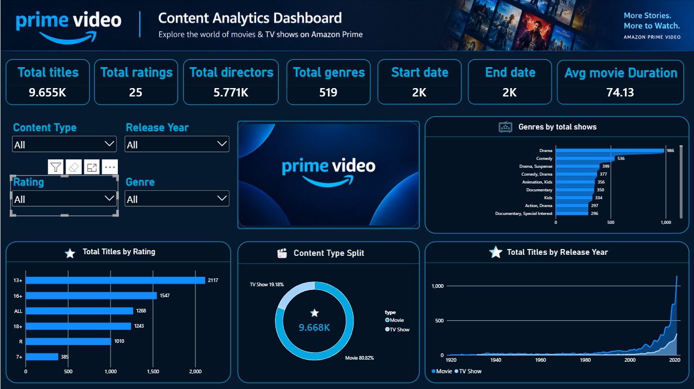
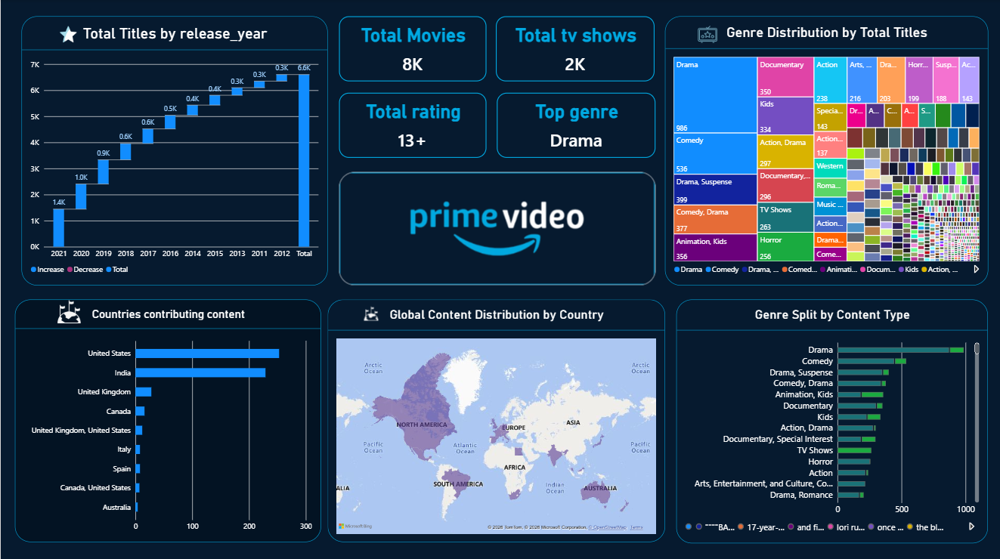

# Amazon Prime Video Content Analytics | Power BI

## 📊 Project Overview

This project analyzes the Amazon Prime Video content catalog using Microsoft Power BI.

The dashboard provides insights into movies and TV shows based on content type, ratings, genres, countries, release years, and movie duration.

## 🎯 Problem Statement

Amazon Prime Video has a large and diverse content catalog. Analyzing raw content data can make it difficult to quickly understand content distribution and trends.

The objective of this project was to transform raw content data into meaningful insights through an interactive Power BI dashboard.

## 🛠️ Tools & Technologies

- Microsoft Power BI
- Power Query
- DAX
- Data Cleaning
- Data Transformation
- Data Modeling
- Data Visualization

## 🔄 Project Approach

Data Collection
↓
Data Cleaning
↓
Data Transformation
↓
Data Modeling
↓
DAX Measures
↓
Dashboard Development
↓
Insights

## 📈 Key KPIs

| KPI | Value |
|---|---:|
| Total Titles | 9.655K |
| Movies | 80.82% |
| TV Shows | 19.18% |
| Average Movie Duration | 74.13 min |
| Directors | 5.771K |
| Rating Categories | 25 |
| Genre Entries | 519 |

## 🎛️ Dashboard Features

The dashboard includes interactive slicers for:

- Content Type
- Release Year
- Rating
- Country
- Genre

## 🧹 Data Preparation

Power Query was used for:

- Handling missing values
- Removing duplicates
- Transforming data types
- Cleaning date and duration fields
- Preparing genre and country information

## 📊 Dashboard Preview

### Executive Overview

### Content Deep Dive

## 💡 Key Insights

- Movies represent the majority of the catalog.
- Drama is one of the major genre categories.
- The dashboard provides visibility into rating distribution.
- Content can be analyzed across countries and release years.
- Interactive slicers allow users to explore different segments of the catalog.

## 🚀 Learning Outcomes

This project helped strengthen my skills in:

Power BI | Power Query | DAX | Data Modeling | Data Visualization | Analytical Storytelling

## 📁 Project Files

- `.pbix` — Power BI dashboard
- `Dashboard/` — Dashboard screenshots
- `Documentation/` — Project documentation

## 👤 Author

Raj

#PowerBI #DataAnalytics #DataVisualization #DAX #PowerQuery
